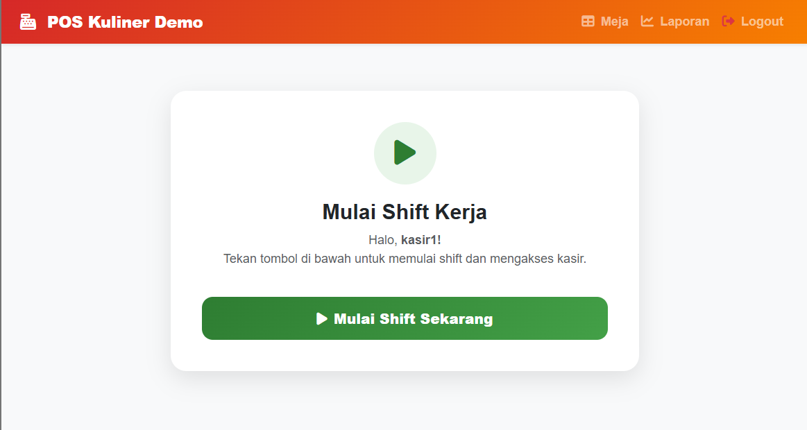
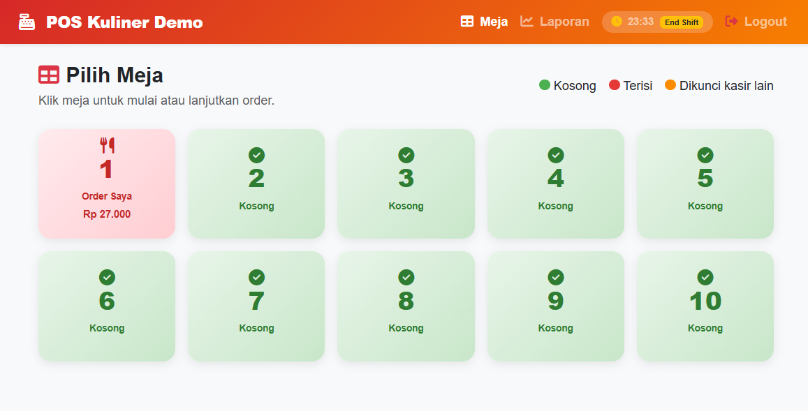
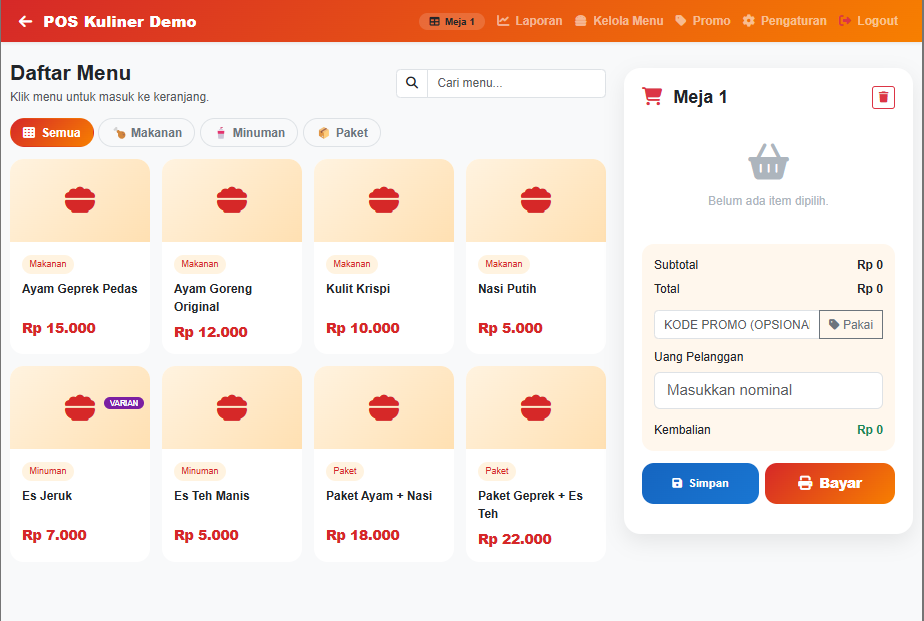
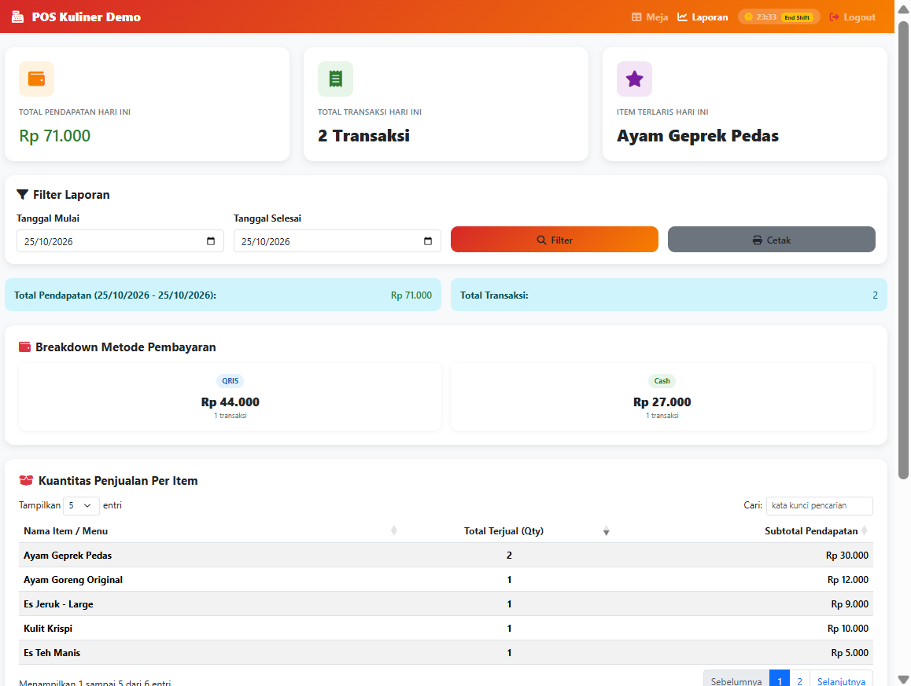
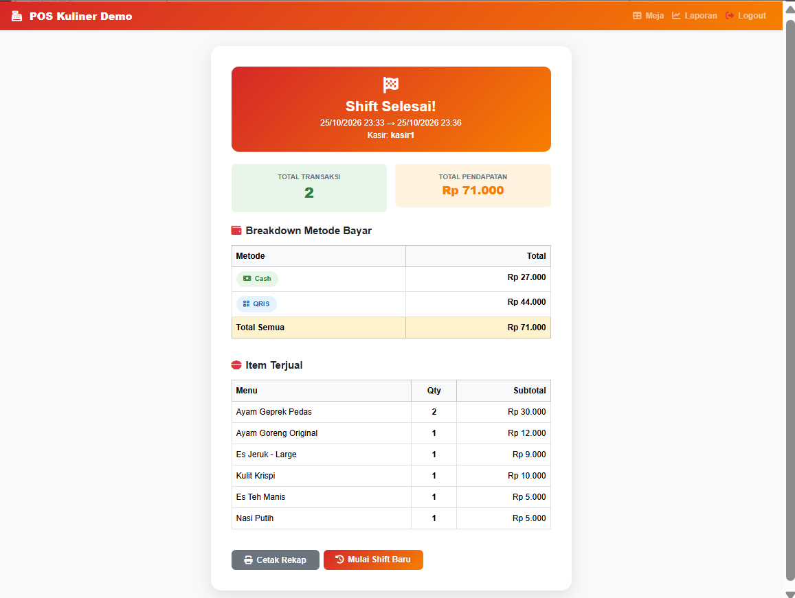

# 🍗 POS Kuliner — Sistem Kasir Restoran

Aplikasi Point of Sale (POS) berbasis web untuk usaha kuliner, dibangun dengan **PHP (PDO), MySQL/MariaDB, dan Bootstrap 5**. Mendukung manajemen meja (open bill), shift kasir, varian & stok menu, kode promo, beberapa metode pembayaran, dan laporan penjualan.









---

## ✨ Fitur

**Autentikasi & akses**
- Login dengan password ter-hash (bcrypt), dua role: **Admin** dan **Kasir**
- Kasir wajib memulai shift sebelum bertransaksi; rekap shift tampil saat shift diakhiri

**Meja & transaksi**
- Grid 10 meja dengan status real-time (kosong / terisi / dipegang pengguna lain)
- *Open bill*: order disimpan per meja dan bisa dibayar nanti
- Keranjang real-time, filter kategori, pencarian menu
- Kode promo (persen / nominal, dengan minimum transaksi, kuota, dan periode)
- Metode bayar: Cash, QRIS, Debit, Kredit, Gojek, GrabFood, ShopeeFood
- Cetak struk otomatis

**Menu**
- CRUD menu (Makanan, Minuman, Paket) dengan foto
- Varian per menu (mis. *Es Jeruk — Reguler / Large*) dan stok per menu/varian
- Menu otomatis nonaktif saat stok habis

**Laporan**
- Ringkasan hari ini, filter periode, breakdown metode bayar, item terlaris
- Detail transaksi dan cetak ulang struk

**Pengaturan toko**: nama, tagline, alamat, telepon, footer struk (dengan preview struk).

---

## 🛠️ Teknologi & Kebutuhan

| Komponen | Keterangan |
|---|---|
| Backend | PHP **8.1+** (disarankan 8.3 ke atas dan sudah ter-patch, lihat catatan di bawah) |
| Ekstensi PHP | `pdo_mysql`, `mbstring`, `fileinfo` (wajib) · `gd`, `exif` (disarankan, untuk memproses foto menu) |
| Database | MySQL 5.7+ / 8.x atau MariaDB 10.4+ |
| Web server | Apache 2.4 dengan `AllowOverride All` (bawaan Laragon & XAMPP) |
| Frontend | Bootstrap 5.3, Font Awesome 6.5, DataTables 1.13 (dimuat dari CDN) |

> **Catatan keamanan runtime:** pada Oktober 2026 PHP merilis perbaikan untuk celah kritis eksekusi kode jarak jauh. Gunakan PHP minimal **8.3.36 / 8.4.27 / 8.5.12** (atau lebih baru), dan jangan jalankan aplikasi di PHP 8.1 ke bawah pada server yang bisa diakses publik.

---

## 🚀 Instalasi Lokal (Laragon atau XAMPP)

### 1. Taruh project di folder web server

| Server | Lokasi |
|---|---|
| Laragon | `C:\laragon\www\pos-kuliner\` |
| XAMPP | `C:\xampp\htdocs\pos-kuliner\` |

### 2. Buat file konfigurasi

```bash
copy config\config.example.php config\config.php      # Windows (CMD)
cp config/config.example.php config/config.php        # Linux / macOS
```

Bawaan Laragon dan XAMPP (`root` tanpa password) sudah sesuai, jadi biasanya tidak perlu diubah. `config/config.php` **tidak ikut di-commit** (ada di `.gitignore`).

### 3. Import database

Nyalakan Apache dan MySQL, lalu import **`database/schema.sql`** (file ini otomatis membuat database `pos_kuliner`, tabel, dan data demo):

- **HeidiSQL / phpMyAdmin** → Import → pilih `database/schema.sql`, atau
- Command line: `mysql -u root < database/schema.sql`

### 4. Buka aplikasi

```
http://localhost/pos-kuliner/
```

Di Laragon, alamat otomatis `http://pos-kuliner.test/` juga bisa dipakai. Lokasi aplikasi di URL (`BASE_URL`) dideteksi otomatis; kalau gagal, set manual di `config/config.php`.

### Upgrade dari database lama
Kalau database dibuat dari versi sebelum perbaikan keamanan, jalankan sekali `database/migrations/001_login_attempts.sql` (menambah tabel pembatas percobaan login).

---

## 👤 Akun Demo

| Username | Password | Role |
|---|---|---|
| `admin` | `Admin@12345` | Admin |
| `kasir1` | `Kasir@12345` | Kasir |

> ⚠️ Akun ini hanya untuk demo lokal. **Ganti atau hapus** sebelum aplikasi dipasang di server yang bisa diakses orang lain.

---

## 🔒 Keamanan

Yang sudah diterapkan dan diuji:

- **Query**: seluruhnya memakai PDO *prepared statement*.
- **Password**: `password_hash` / `password_verify` (bcrypt); respons login dibuat sama baik user ada maupun tidak.
- **Sesi**: cookie `HttpOnly` + `SameSite=Lax` (+ `Secure` otomatis lewat HTTPS), `use_strict_mode`, ID sesi diganti saat login (anti *session fixation*), cookie dihapus saat logout.
- **Pembatasan login**: maksimal 5 percobaan gagal per alamat IP dalam 15 menit.
- **CSRF**: token di semua form dan di semua endpoint AJAX yang mengubah data (header `X-CSRF-Token`). Aksi destruktif (hapus menu, bersihkan meja) hanya lewat `POST`, tidak lewat link.
- **Integritas transaksi**: browser hanya mengirim *apa yang dibeli*. Harga, nama item, diskon, total, kembalian, shift, dan nomor meja **dihitung ulang di server** dari database; promo (kuota, periode, minimum) divalidasi ulang; stok dicek dan dikunci (`SELECT … FOR UPDATE`) sehingga tidak bisa negatif walau dua kasir membayar bersamaan.
- **Kepemilikan order**: kasir tidak bisa menimpa atau membayar order meja milik pengguna lain.
- **Upload foto menu**: tipe ditentukan dari *isi* file, ekstensi ditentukan dari tipe (bukan dari nama file), nama diacak, dimensi dibatasi, dan gambar di-*encode* ulang (GD) sehingga payload tersembunyi terbuang. Folder upload dilarang mengeksekusi script (`assets/img/menu/.htaccess`).
- **Output**: data dari database di-escape (`htmlspecialchars` di PHP, `escapeHtml` di JavaScript).
- **Konfigurasi & rahasia**: kredensial hanya di `config/config.php` (di-gitignore); folder `config/` dan `database/` tidak bisa diakses lewat browser; pesan error teknis dicatat ke log server, bukan ditampilkan ke pengguna.

Keterbatasan yang perlu diketahui:

- Belum ada paksaan HTTPS; di produksi **wajib** dipasang di belakang HTTPS.
- Pembatasan login berbasis IP, belum ada 2FA maupun log audit.
- Halaman Laporan sengaja terbuka untuk semua pengguna yang sudah login (termasuk kasir).
- Bootstrap, Font Awesome, dan DataTables dimuat dari CDN tanpa *Subresource Integrity*.
- Belum ada *automated test* di repositori ini.

---

## 📁 Struktur Folder

```
pos-kuliner/
├── ajax/                      # Endpoint JSON
│   ├── cek_promo.php          # Pratinjau promo di keranjang
│   ├── detail_transaksi.php   # Detail transaksi (Laporan)
│   ├── simpan_order.php       # Simpan order aktif per meja (open bill)
│   └── simpan_transaksi.php   # Pembayaran (harga dihitung di server)
├── assets/
│   ├── css/style.css
│   ├── img/menu/              # Foto menu (upload; isinya tidak di-commit)
│   └── js/kasir.js            # Logika halaman kasir
├── config/
│   ├── bootstrap.php          # Muat config, sesi aman, fungsi bantu
│   ├── config.example.php     # Template konfigurasi (salin ke config.php)
│   ├── functions.php          # CSRF, JSON, promo, upload, dll.
│   ├── koneksi.php            # Koneksi PDO
│   └── navbar.php
├── database/
│   ├── schema.sql             # Skema + data demo
│   └── migrations/            # Migrasi untuk database lama
├── docs/screenshots/
├── pages/                     # laporan, meja, menu (+varian), promo, pengaturan
├── index.php                  # Halaman kasir
├── login.php · logout.php · shift.php
└── .htaccess
```

---

## 📋 Hak Akses

| Fitur | Admin | Kasir |
|---|:-:|:-:|
| Halaman kasir & pilih meja | ✅ | ✅ |
| Laporan penjualan | ✅ | ✅ |
| Kelola menu, stok & varian | ✅ | ❌ |
| Kelola promo | ✅ | ❌ |
| Pengaturan toko | ✅ | ❌ |
| Bersihkan meja yang dipegang orang lain | ✅ | ❌ |
| Start / End shift | ❌ | ✅ |

---

## 🌐 Deploy ke Server (Checklist)

- [ ] PHP sudah ter-patch (lihat catatan di atas), cek lewat `php -v` atau `phpinfo()` di hosting
- [ ] Pasang **HTTPS**
- [ ] Buat user database khusus (bukan `root`) dengan hak `SELECT, INSERT, UPDATE, DELETE`, lalu isi `config/config.php`
- [ ] `APP_DEBUG` bernilai `false`
- [ ] Ganti / hapus akun demo dan buat password yang kuat
- [ ] Pastikan `.htaccess` aktif (`AllowOverride All`); coba buka `/config/config.php` dan `/database/schema.sql` di browser, keduanya harus ditolak (403)
- [ ] Folder `assets/img/menu/` bisa ditulis oleh web server
- [ ] Backup database secara berkala

---

## 🤝 Credit

Dikembangkan sebagai project sistem POS untuk usaha kuliner. Memakai [Bootstrap](https://getbootstrap.com), [Font Awesome](https://fontawesome.com), dan [DataTables](https://datatables.net).

© 2026 Titan Faranzano. Source code ditampilkan untuk dilihat dan dipelajari; penggunaan ulang tidak diizinkan tanpa izin tertulis.
